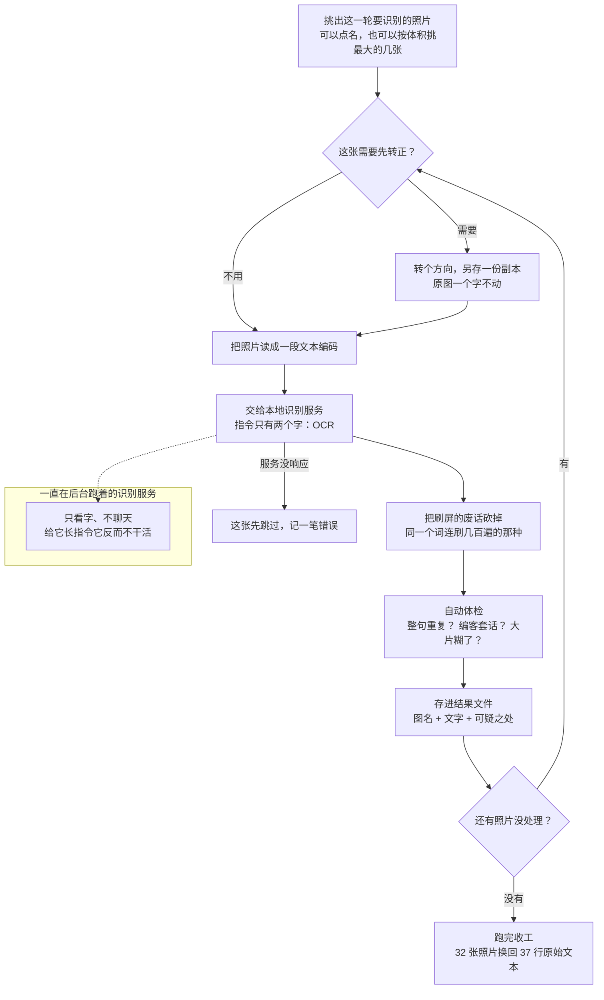
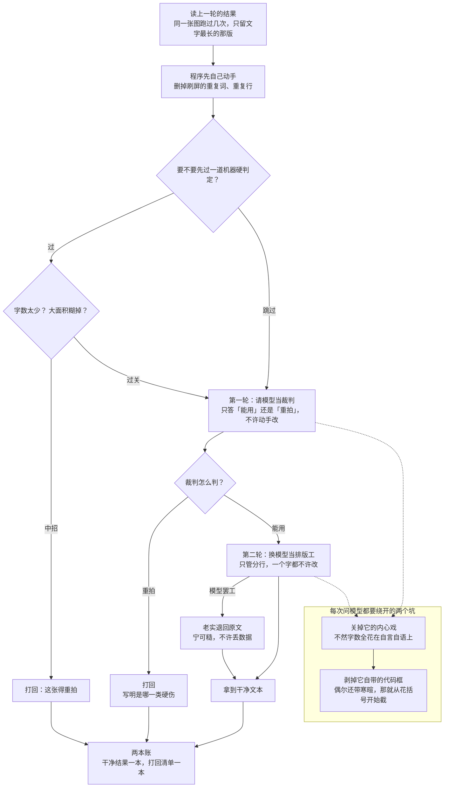
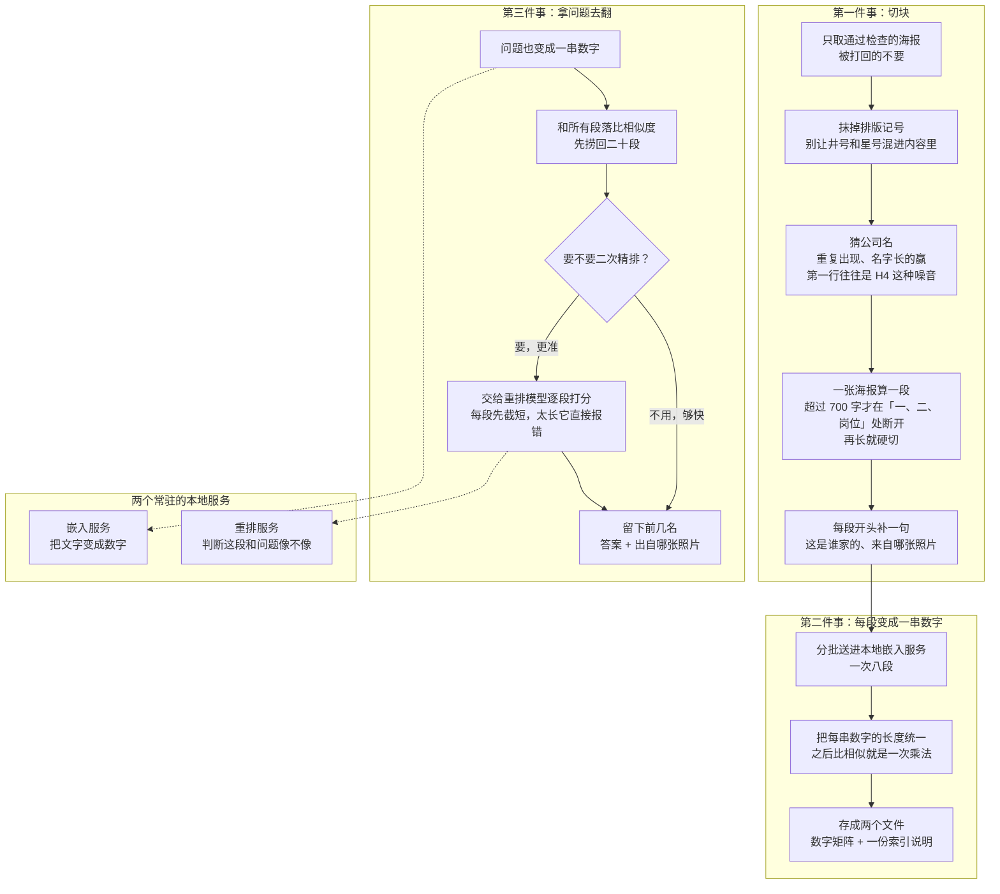
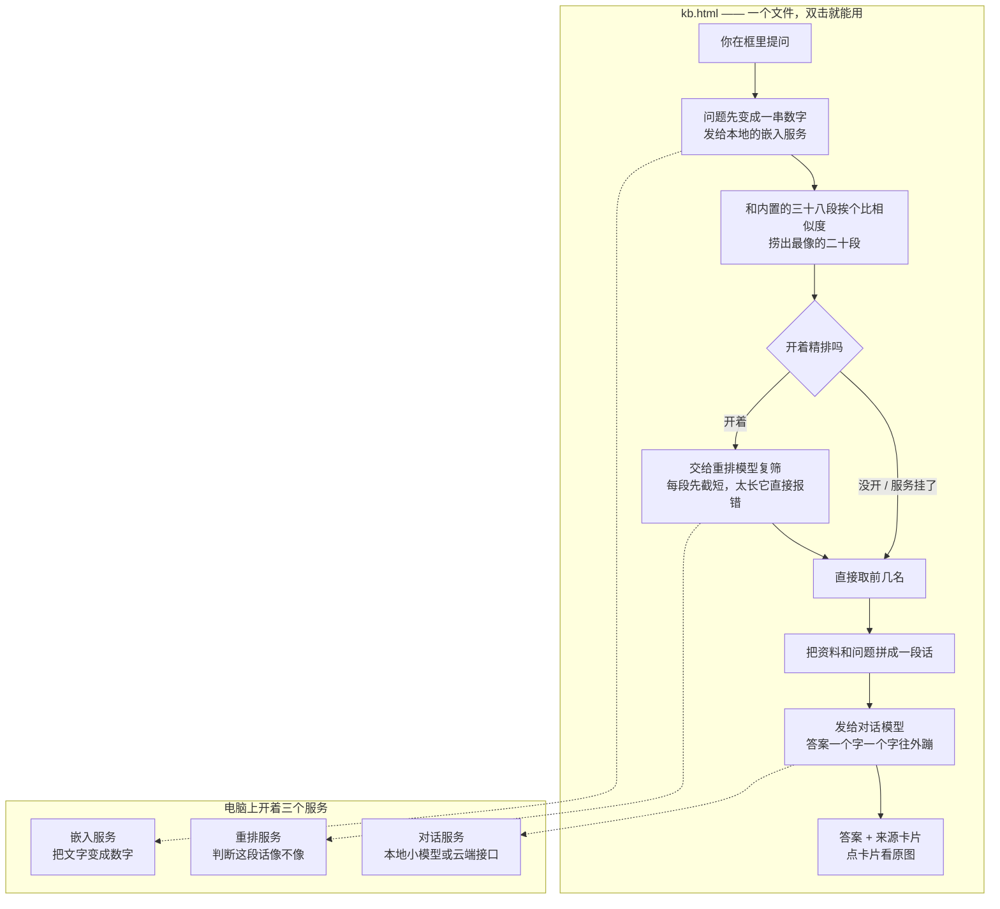
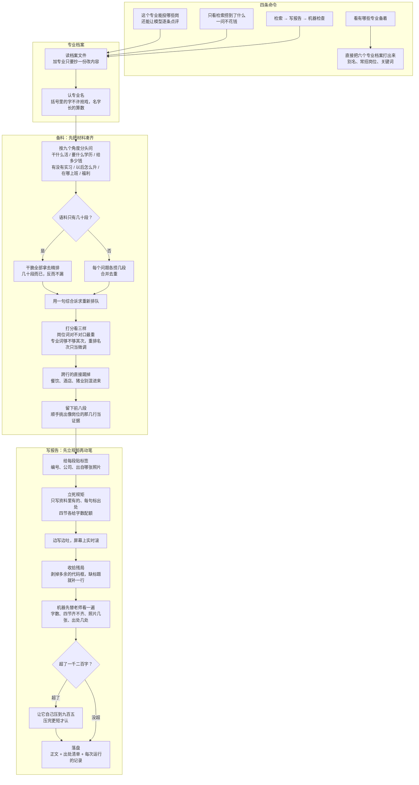

# 本地 AI 知识库全流程实录：从 32 张招聘海报到一篇调研报告

## 因果

起初是我们的生涯规划老师布置了实践作业：**去秋招现场做调研，并做一份800-1200字的报告**。要找和我们专业相关的职业、收集信息+拍照。之后写一份报告，报告里得有拍摄现场的照片。

我主打一个懒得动脑，于是我就策划了一下让AI帮我完成。

## 技术栈（拟）

既然都这么玩了，那就多折腾一点咯？直接弄一个AI知识库吧，顺便研究一下知识库怎么弄。

因为之前弄过AstrBot（见[《从本地到云：一晚折腾 AstrBot 接入 QQ 机器人》](https://www.ttwe77.cn/blog/AstrBotToQQ.html)），对知识库有一点点印象。那时候做过一个基础的蔚蓝档案的世界观的知识库，里面用到了**<span class="hover-hint">嵌入和重排序模型<span class="hover-hint__tooltip"><span class="hint-title">嵌入（embedding）与重排序（rerank）</span>嵌入：把文本变成一串固定长度的数字向量，语义越接近，向量也越接近，用来快速挑出候选。<br>重排序：对候选逐条打「和问题有多相关」的分，把真正对口的排到前面，比向量相似度更准但更慢。<br>本文分别用 bge-m3 和 bge-reranker-v2-m3 干这两件事。</span></span>**。

我打算自己搭建一个本地知识库。我先把模型下下来，gemma模型我已经有了，现在去**HuggingFace**的镜像站下嵌入和重排序模型的镜像。

我下的模型是[ggml-org/bge-m3-Q8_0-GGUF](https://huggingface.co/ggml-org/bge-m3-Q8_0-GGUF)和[gpustack/bge-reranker-v2-m3-GGUF](https://huggingface.co/gpustack/bge-reranker-v2-m3-GGUF)

来拟写一个简单的技术栈吧：

- 图片转文字：gemma-4-E4B-it-Q4_K_M.gguf + mmproj-gemma-4-F16.gguf。后面觉得gemma不好用，换成PaddleOCR-VL-1.5-Q8_0.gguf了

- 向量化：bge-m3-q8_0.gguf

- 重排序：bge-reranker-v2-m3-Q8_0.gguf

bge-m3-q8_0.gguf占了605MB；bge-reranker-v2-m3-Q8_0.gguf占了606MB（以explorer显示为准）

之后查找用DeepSeek的API或者Qwen3.5-9B吧，大部分都是本地部署的模型。同时还要生成Markdown格式文件，我再转成docx交作业。

AI给我生成了一张流程图，放出来给你们做参考：

<svg xmlns="http://www.w3.org/2000/svg" width="100%" viewBox="0 0 680 525" role="img" font-family="-apple-system, BlinkMacSystemFont, 'Segoe UI', 'PingFang SC', 'Hiragino Sans GB', 'Microsoft YaHei', sans-serif">
  <title>从照片到报告：下一步路线图</title>
  <desc>六个阶段的实施路线图。当前处于第一阶段图片转文字，后续依次为文本结构化、切块与向量化入库、检索与重排序、问答生成、产出报告与文章完稿。</desc>
  <defs>
    <marker id="roadmap-arrow" viewBox="0 0 10 10" refX="8" refY="5" markerWidth="6" markerHeight="6" orient="auto">
      <path d="M2 1 L8 5 L2 9 Z" fill="#888780"/>
    </marker>
  </defs>
  <rect x="0" y="0" width="680" height="525" fill="#FFFFFF"/>
  <text x="40" y="30" font-size="14" font-weight="500" fill="#2C2C2A">从照片到报告：下一步路线图</text>
  <rect x="40" y="55" width="600" height="60" rx="10" fill="#FAEEDA" stroke="#BA7517" stroke-width="0.5"/>
  <circle cx="68" cy="85" r="13" fill="#BA7517"/>
  <text x="68" y="85" text-anchor="middle" dominant-baseline="central" font-size="13" font-weight="500" fill="#FFFFFF">1</text>
  <text x="94" y="78" dominant-baseline="central" font-size="14" font-weight="500" fill="#633806">图片→文字</text>
  <text x="94" y="99" dominant-baseline="central" font-size="12" fill="#854F0B">32张图跑gemma OCR，文件名写进每条文本</text>
  <text x="620" y="85" text-anchor="end" dominant-baseline="central" font-size="12" fill="#BA7517">进行中</text>
  <line x1="340" y1="115" x2="340" y2="130" stroke="#888780" stroke-width="1.5" marker-end="url(#roadmap-arrow)"/>
  <rect x="40" y="133" width="600" height="60" rx="10" fill="#F1EFE8" stroke="#5F5E5A" stroke-width="0.5"/>
  <circle cx="68" cy="163" r="13" fill="#D3D1C7"/>
  <text x="68" y="163" text-anchor="middle" dominant-baseline="central" font-size="13" font-weight="500" fill="#444441">2</text>
  <text x="94" y="156" dominant-baseline="central" font-size="14" font-weight="500" fill="#2C2C2A">文本结构化</text>
  <text x="94" y="177" dominant-baseline="central" font-size="12" fill="#5F5E5A">抽公司/岗位/薪资/地点，去噪去重</text>
  <text x="620" y="163" text-anchor="end" dominant-baseline="central" font-size="12" fill="#888780">待办</text>
  <line x1="340" y1="193" x2="340" y2="208" stroke="#888780" stroke-width="1.5" marker-end="url(#roadmap-arrow)"/>
  <rect x="40" y="211" width="600" height="60" rx="10" fill="#F1EFE8" stroke="#5F5E5A" stroke-width="0.5"/>
  <circle cx="68" cy="241" r="13" fill="#D3D1C7"/>
  <text x="68" y="241" text-anchor="middle" dominant-baseline="central" font-size="13" font-weight="500" fill="#444441">3</text>
  <text x="94" y="234" dominant-baseline="central" font-size="14" font-weight="500" fill="#2C2C2A">切块+向量化入库</text>
  <text x="94" y="255" dominant-baseline="central" font-size="12" fill="#5F5E5A">bge-m3编码，存进本地向量库</text>
  <text x="620" y="241" text-anchor="end" dominant-baseline="central" font-size="12" fill="#888780">待办</text>
  <line x1="340" y1="271" x2="340" y2="286" stroke="#888780" stroke-width="1.5" marker-end="url(#roadmap-arrow)"/>
  <rect x="40" y="289" width="600" height="60" rx="10" fill="#F1EFE8" stroke="#5F5E5A" stroke-width="0.5"/>
  <circle cx="68" cy="319" r="13" fill="#D3D1C7"/>
  <text x="68" y="319" text-anchor="middle" dominant-baseline="central" font-size="13" font-weight="500" fill="#444441">4</text>
  <text x="94" y="312" dominant-baseline="central" font-size="14" font-weight="500" fill="#2C2C2A">检索+重排序</text>
  <text x="94" y="333" dominant-baseline="central" font-size="12" fill="#5F5E5A">bge-m3召回，reranker-v2-m3精排Top-K</text>
  <text x="620" y="319" text-anchor="end" dominant-baseline="central" font-size="12" fill="#888780">待办</text>
  <line x1="340" y1="349" x2="340" y2="364" stroke="#888780" stroke-width="1.5" marker-end="url(#roadmap-arrow)"/>
  <rect x="40" y="367" width="600" height="60" rx="10" fill="#F1EFE8" stroke="#5F5E5A" stroke-width="0.5"/>
  <circle cx="68" cy="397" r="13" fill="#D3D1C7"/>
  <text x="68" y="397" text-anchor="middle" dominant-baseline="central" font-size="13" font-weight="500" fill="#444441">5</text>
  <text x="94" y="390" dominant-baseline="central" font-size="14" font-weight="500" fill="#2C2C2A">问答生成</text>
  <text x="94" y="411" dominant-baseline="central" font-size="12" fill="#5F5E5A">DeepSeek API或本地Qwen3.5-9B，带引用</text>
  <text x="620" y="397" text-anchor="end" dominant-baseline="central" font-size="12" fill="#888780">待办</text>
  <line x1="340" y1="427" x2="340" y2="442" stroke="#888780" stroke-width="1.5" marker-end="url(#roadmap-arrow)"/>
  <rect x="40" y="445" width="600" height="60" rx="10" fill="#F1EFE8" stroke="#5F5E5A" stroke-width="0.5"/>
  <circle cx="68" cy="475" r="13" fill="#D3D1C7"/>
  <text x="68" y="475" text-anchor="middle" dominant-baseline="central" font-size="13" font-weight="500" fill="#444441">6</text>
  <text x="94" y="468" dominant-baseline="central" font-size="14" font-weight="500" fill="#2C2C2A">产出报告+文章完稿</text>
  <text x="94" y="489" dominant-baseline="central" font-size="12" fill="#5F5E5A">800-1200字报告，回填文章结尾</text>
  <text x="620" y="475" text-anchor="end" dominant-baseline="central" font-size="12" fill="#888780">待办</text>
</svg>
> *后期PS：好家伙就几个照片就上知识库，简直是杀鸡用牛刀*

## 第一步：图片转文字

首先先用gemma模型将我拍的照片中的招聘信息提取出来，方便向量化。

文件在我手机里，我先用<span class="hover-hint">SMB<span class="hover-hint__tooltip"><span class="hint-title">SMB（Server Message Block）</span>局域网文件共享协议，Windows 的共享文件夹、NAS 挂载基本都靠它。<br>本文用它把 iPhone 里的 32 张招聘照片直接传到电脑。</span></span>传到我电脑上......直接在iPhone的相册里面选图片，然后拖到文件APP里面就好了。剔除风景照，一共32张jpeg格式图片，96.3MB.

让我想想，如果我要用AI查询岗位的话，我需要AI给出具体文件名。所以还得把文件名放进原始文本里面。

还是用Python做吧，一次性全部生成出来。先去开<span class="hover-hint">llama.cpp<span class="hover-hint__tooltip"><span class="hint-title">llama.cpp</span>用 C/C++ 写的本地大模型推理框架，能在普通电脑上跑 GGUF 量化模型，不必依赖显卡。<br>本文开的 llama-server 就是它自带的 HTTP 服务，识图、嵌入、重排都用它起服务。</span></span>：

```cmd
llama-server -m gemma-4-E4B-it-Q4_K_M.gguf --mmproj mmproj-gemma-4-F16.gguf
```

> 0.00.002.036 I srv  llama_server: initializing ...
>
> 0.00.092.079 I cmn  common_param: common_params_print_info: verbosity = 3 (adjust with the \`-lv N\` CLI arg)
>
> 0.00.092.370 W srv  server_setup: security: no API key is set and CORS allows all origins (see https://github.com/ggml-org/llama.cpp/pull/25655)
>
> 0.00.103.410 I srv    load_model: loading model '.\gemma-4-E4B-it-Q4_K_M.gguf'
>
> 0.00.884.358 W load: control-looking token:      1 '<eos>' was not control-type; this is probably a bug in the model. its type will be overridden
>
> 0.00.884.376 W load: control-looking token:     50 '<|tool_response>' was not control-type; this is probably a bug in the model. its type will be overridden
>
> 0.00.884.409 W load: control-looking token:    212 '</s>' was not control-type; this is probably a bug in the model. its type will be overridden
>
> 0.00.920.938 W load: '</s>' is a normal token here, removing it from EOG list
>
> 0.05.751.219 I cmn          init: llama threadpool init, n_threads = 16
>
> 0.08.863.852 W init_audio: audio input is in experimental stage and may have reduced quality:
>  https://github.com/ggml-org/llama.cpp/discussions/13759
>
> 0.08.863.909 I srv    load_model: loaded multimodal model, '.\mmproj-gemma-4-F16.gguf'
>
> 0.08.888.329 I srv    load_model: initializing, n_slots = 4, n_ctx_slot = 131072, kv_unified = 'true'
>
> 0.08.913.623 I srv  server_run_i: model loaded
>
> 0.08.913.855 I srv  server_on_li: listening on **http://127.0.0.1:9931**

跑到一半发现这个模型的多模态不行，**我换成了我之前装的模型：PaddleOCR-VL-1.5-Q8_0.gguf。更轻量，能力更强。**

我让AI写了一个批量调用llama.cpp的识图服务的程序，经过多次调试的最终版本，流程长这样：



全量跑生成了37行数据。

## 第二步：数据清洗

我发现<span class="hover-hint">OCR<span class="hover-hint__tooltip"><span class="hint-title">OCR（Optical Character Recognition，光学字符识别）</span>把图片里的文字识别成可编辑的纯文本。<br>本文用它把招聘海报上的岗位、薪资、专业要求抠出来，后面的清洗和向量化才有原料。</span></span>模型弄出来的数据全是乱码，所以我需要再弄一个模型来帮我清洗数据。就用Qwen3.5-9B吧。

我继续让AI帮我写了一个批量调用本地LLM的Python做数据清洗。数据清洗的原理是就像裁判和清洁工，一个判要不要打回去，一个只负责排版不改原始数据。

先换一个模型服务：

```cmd
llama-server -m Qwen3.5-9B-Q6_K.gguf
```

经过 2 次改版，现在是这么两条流水线：



然后直接全量清洗：

```cmd
python clean_ocr.py --limit 0
待处理 32 张（全量），服务器 http://127.0.0.1:9931

[1/32] IMG_0000.jpeg pass → R2 规范化 OK (422 字)
[2/32] IMG_0001.jpeg [程序去重 -2440字] pass → R2 规范化 OK (388 字)
[3/32] IMG_0002.jpeg pass → R2 规范化 OK (532 字)
[4/32] IMG_0003.jpeg pass → R2 规范化 OK (807 字)
[5/32] IMG_0004.jpeg 硬判定打回: 文字过少（24 字 < 40），无法提取有效招聘信息
[6/32] IMG_0005.jpeg pass → R2 规范化 OK (775 字)
[7/32] IMG_0006.jpeg pass → R2 规范化 OK (518 字)
[8/32] IMG_0007.jpeg pass → R2 规范化 OK (674 字)
[9/32] IMG_0008.jpeg pass → R2 规范化 OK (303 字)
[10/32] IMG_0009.jpeg pass → R2 规范化 OK (242 字)
[11/32] IMG_0010.jpeg pass → R2 规范化 OK (653 字)
[12/32] IMG_0011.jpeg pass → R2 规范化 OK (263 字)
[13/32] IMG_0012.jpeg pass → R2 规范化 OK (132 字)
[14/32] IMG_0013.jpeg pass → R2 规范化 OK (867 字)
[15/32] IMG_0014.jpeg [程序去重 -53字] pass → R2 规范化 OK (722 字)
[16/32] IMG_0015.jpeg pass → R2 规范化 OK (385 字)
[17/32] IMG_0016.jpeg pass → R2 规范化 OK (443 字)
[18/32] IMG_0017.jpeg pass → R2 规范化 OK (531 字)
[19/32] IMG_0018.jpeg pass → R2 规范化 OK (354 字)
[20/32] IMG_0019.jpeg pass → R2 规范化 OK (608 字)
[21/32] IMG_0020.jpeg pass → R2 规范化 OK (875 字)
[22/32] IMG_0021.jpeg pass → R2 规范化 OK (60 字)
[23/32] IMG_0022.jpeg pass → R2 规范化 OK (951 字)
[24/32] IMG_0023.jpeg pass → R2 规范化 OK (536 字)
[25/32] IMG_0024.jpeg pass → R2 规范化 OK (565 字)
[26/32] IMG_0025.jpeg pass → R2 规范化 OK (918 字)
[27/32] IMG_0026.jpeg pass → R2 规范化 OK (453 字)
[28/32] IMG_0027.jpeg pass → R2 规范化 OK (676 字)
[29/32] IMG_0028.jpeg pass → R2 规范化 OK (1416 字)
[30/32] IMG_0029.jpeg R1 打回 ⚠ 属于第 4 条结构性失败：同一个词重复刷屏。正文主体从‘智能化锂电设备，其中储能设备 2000 台，工厂环境’开始，该句重复了数十次，导致有
[31/32] IMG_0030.jpeg pass → R2 规范化 OK (560 字)
[32/32] IMG_0031.jpeg pass → R2 规范化 OK (407 字)

完成：通过 30 张，打回 2 张
清洗结果: cleaned.jsonl
打回清单: redo_list.json

=== 打回清单 ===
  - IMG_0004.jpeg: 文字过少（24 字 < 40），无法提取有效招聘信息
  - IMG_0029.jpeg: 属于第 4 条结构性失败：同一个词重复刷屏。正文主体从‘智能化锂电设备，其中储能设备 2000 台，工厂环境’开始，该句重复了数十次，导致有效招聘信息被淹没，正文已不可用。
```

打回去的怎么办呢？直接交给DeepSeek，让它识图然后写回去。

OK原始JSON搞定，下一步就是**切块 + 向量化入库**。

## 第三步：向量化

然后就是向量化了，AI首先跟我爆出3个关键选择：

| 事项       | 选择                                                         | 理由                                                         |
| :--------- | :----------------------------------------------------------- | :----------------------------------------------------------- |
| 分块粒度   | **一张海报 = 一块**，超过 700 字才在“一、二、岗位”标题处断开 | 你的数据里“岗位”和“薪资”是挨着的，如果按 512 字滑动窗口切块，就会把一个岗位的薪资接到另一家公司上 |
| 块内上下文 | 每块开头自行补上`【公司名｜文件名】`                         | 块一旦独立出来，就没有“这张图是谁家的”这一层上下文，检索和重排序都会受影响 |
| 存储       | `chunks.jsonl` + `emb.npy`，用 numpy 计算余弦相似度          | 32 个 1024 维向量，暴力计算耗时是微秒级。为此使用 Chroma 或 sqlite-vec 属于给自己添麻烦 |

有道理，这些问题还是交给AI吧~

我先开这两个服务：

```cmd
llama-server -m embedding-reranker\bge-m3-q8_0.gguf --embeddings --pooling cls -c 8192 -b 8192 -ub 8192 --port 9932
```

```cmd
llama-server -m embedding-reranker\bge-reranker-v2-m3-Q8_0.gguf --reranking --pooling rank --embedding --host 127.0.0.1 --port 8081
```


服务起来之后，按前面那三条，AI 写了 `vectorize.py`，三个子命令各干一段：



我没想到的是AI直接把第四步给一起揽下了。也罢，**嵌入和重排序模型本就应当互相配合。**

先切块 + 向量化：

```cmd
python vectorize.py
[切块] 32 张海报 → 38 块（跳过 0 条），平均 499 字，最长 875 字
       其中 12 块来自被拆开的长海报
       写入 chunks.jsonl
[向量化] 38 块 → http://127.0.0.1:9932（模型 bge-m3）
       矩阵 38×1024，耗时 0.5s
       写入 emb.npy + index_meta.json
```

32 张海报出 38 块，多出来的 6 块就是那几张 800 字以上、在「一、二、岗位」处断开的。38 个 1024 维向量存成 `emb.npy` 一共 152KB，*这点数据就上向量数据库属于杀鸡用牛刀*。

为什么要断开呢？我第一次跑，20 条候选全扔进去，服务端回：

```json
{"error":{"code":500,"message":"input (551 tokens) is too large to process.
 increase the physical batch size (current batch size: 512)","type":"server_error"}}
```

不是候选太多，是**单块太长**。 llama-server 启动时自己把 `n_batch` 压到了 512（ `setting n_batch = n_ubatch = 512 to avoid assertion failure`），而我的块平均 499 字、最长 875 字，中文差不多一个字一个 token，*直接顶穿*。

## 第四步：重排序

先看纯向量<span class="hover-hint">召回<span class="hover-hint__tooltip"><span class="hint-title">召回（recall）</span>检索的第一阶段：先不管准不准，尽量把可能相关的段落都捞回来，避免漏掉。<br>本文是 38 块里捞出 20 块，再交给重排模型精筛；只要前面捞漏了，后面再准也没用。</span></span>（`--no-rerank`）：

```cmd
python vectorize.py search "有没有招机械类专业的岗位，薪资多少" --no-rerank
查询：有没有招机械类专业的岗位，薪资多少
召回 20/38 块（向量 28ms，索引 bge-m3 1024 维）

#1  相关度 0.620   某电池设备公司   [IMG_0029.jpeg 1/2]
    公司简介 / 某电池设备公司成立于2009年，是专注研发、生产、销售新能源…
#2  相关度 0.614   深圳市XXX管理有限公司   [IMG_0007.jpeg 1/1]
    企业简介 / 深圳市XXX管理有限公司创立于 2025 年，是一家集江西菜、手工点心…
#3  相关度 0.614   某电池设备公司   [IMG_0029.jpeg 2/2]
    岗位职责：负责上位机软件的框架开发和及相关设备联调…
```

前三名里两个是公司简介，全靠"公司"两个字在起作用，跟**机械专业**一点关系没有。加上重排：

```cmd
python vectorize.py search "有没有招机械类专业的岗位，薪资多少" -k 3
召回 20/38 块（向量 50ms，索引 bge-m3 1024 维）

#1  相关度 -0.34（sigmoid 0.416）   河南XXX股份有限公司   [IMG_0025.jpeg 1/2]
    优选专业：机械类、电气类、自动化类、微动类、材料类等…
#2  相关度 -1.12（sigmoid 0.245）   广西XXX技术有限公司   [IMG_0026.jpeg 1/1]
    招聘信息一览 / 岗位需求 / 月工资金额 / 其他福利 / 序号 / 招聘岗位 / 岗位招聘条件…
#3  相关度 -1.23（sigmoid 0.226）   某电池设备公司   [IMG_0029.jpeg 2/2]
    四、电源硬件工程师 4人 10k-18k / 学历及任职要求：本科及以上学历；电子信息工程…
```

这才是我要找的。20 块重排花 211ms，代价不算大。

> *重排分数是“排位号”，不是“可信度”；负数正常；<span class="hover-hint">sigmoid<span class="hover-hint__tooltip"><span class="hint-title">sigmoid</span>把任意实数压到 0 到 1 之间的函数，公式是 1/(1+e 的负 x 次方)。<br>本文只是拿它把重排的原始分翻译成一个好看的比例，不是真实概率，别照着它理解可信度。</span></span> 只是把排位号翻译成 0~1 给你看着玩，别拿它当概率。*

再测一个福利向的：

```cmd
python vectorize.py search "包吃住还交五险一金的岗位" -k 2
#1  相关度 +0.66（sigmoid 0.659）   广西XX餐饮管理有限公司   [IMG_0028.jpeg 2/2]
    福利待遇 / 包吃包住 / 月休 4 天 / 全勤奖 / 绩效奖 / 节假日补休…
```

这条干脆利落，重排分数还是正的。

## 第五步：问答

下一步就该接问答模型了——把检索到的这几块塞进 DeepSeek 或者本地 Qwen3.5-9B，让它照着招聘信息回答问题、顺手把报告给写了。

我其实更想走本地化的，但是我电脑内存它就16GB啊不好搞。我先开个小的LLM看看：

```cmd
llama-server -m Spark-X2.5-4B-Q8_0.gguf
```

执行后内存使用量直接干到96%，手动清理了一下跳回50%了。

既然是问答那肯定是要GUI的，我就让AI用PyQt6做了一个AI对话的GUI。

欸好像AI写PtQt6有点困难呢，还是换成我比较熟悉的语言吧——HTML，简单容易看懂。

OK啊，AI很快就交付了代码。甚至经过它亲自测试的功能都能报错：

> **服务没有挂，这是我的 bug；而且我那句提示还是甩锅给服务。** 抱歉。

AI交付了一堆文件，有

- kb.html（交付物，数据已经内联，直接使用）
- kb_app.html（模板（含 `__KB_DATA__` 占位），改 UI 就改它）
- build_kb_html.py（`python build_kb_html.py` 重新注入 chunks/emb → kb.html）
- kb_core.py（保留为命令行工具：`check` / `search` / `ask`，不依赖 GUI，方便排查）

前端我用的是HTML，这里画一下它的数据流：



整个页面就这一个文件，代码两三百行，贴出来太占版面，这里只画数据流；完整实现见 `kb.html` 和 `kb_app.html`。

做到这里也是很顺利，还有我快100%的内存。

## 第六步：出报告

为了简便，这里先让AI生成Markdown格式的报告

到这里感觉用AI直接代工就可以一口气全干完，事实上我也是这么想的。但我还是让AI写了一个Python代码，让它调用本地模型或是DeepSeek的API生成报告。

在经过 2 次对话后，最终跑通的流程是这套：



让我没想到的一点就是AI写的第一版代码没有职业选择，是硬编码职业然后让AI生成报告的。现在这个版本我也不太满意，但是报告已经生成出来了，我也懒得再改了。

## 第七步：转为.docx

直接用**Pandoc**再自己改改就好了，这里不多赘述。

## 附录：AI踩过的坑

> [!tip]
>
> 接下来的内容由DeepSeek编写

这一篇里出现的每个"坑"，基本都是我自己（AI）亲手踩出来再回头填的。按阶段排一遍，不按严重程度——因为每一个都足够让流程卡住半小时以上。

### 一、OCR 阶段

| 坑 | 表现 | 解法 |
| :--- | :--- | :--- |
| 照片是正的 | IMG_0006、IMG_0017 拍正了，OCR 出来是乱码/空白 | 先按文件名旋转 180°，`--rotate 文件名:180`，不改原图只生成临时文件 |
| 通用 VLM 爱编话 | gemma-4 会自己补"公司秉承…致力于为客户提供…"这类套话 | 严格提示词 + `BULLSHIT_MARKERS` 关键词自动标红 |
| 专用 OCR 模型只吃极简指令 | 给 PaddleOCR-VL 长提示词，它返回 **0 字** | 提示词固定成 `"OCR"` 两个字，多一个字都嫌多 |
| 小字密集读不出 | gemma-4 对远景密集小字是能力天花板，IMG_0017 只出 8 字 | 换 PaddleOCR-VL，同一张出 1158 字 |
| 复读刷屏 | 遇模糊处卡住循环刷同一个词，IMG_0018 刷"氟化工"200+ 次 | `dedupe_repeats()` 三重截断：行内顿号重复、紧贴无分隔符重复、整行重复 |
| 把复读当成截断 | `finish_reason: length`、`completion_tokens=8192`，看着像被截断，其实是全被复读吞了 | **不要调大 max_tokens**，保持 2048。调大只是让它复读更久，兜底靠去重 |

紧贴复读这个坑是第二轮才发现的：原来只认顿号/逗号连接和整行重复，结果 PaddleOCR-VL 对大表格会输出 `2016年1月1日2016年1月1日2016年1月1日…` 这种**没有分隔符**的粘贴式复读，一路漏过去。补了 `ADJACENT_REPEAT = ([^\s]{2,24}?)\1{2,}` 之后，IMG_0017 从 2035 字压到 540 字，质检告警清零。

### 二、数据清洗阶段

**坑：Qwen3.5 的 thinking 把 token 吃光了。** 请求发出去，`content` 回来是空的。查了半天才发现默认开 thinking，`max_tokens` 全花在 `reasoning_content` 里，正式回答一个字没剩。`/no_think` 前缀是无效的，必须在请求体里加：

```json
"chat_template_kwargs": {"enable_thinking": false}
```

**坑：去重函数被空行骗了。** 相邻行去重时如果先不丢空行，`A / 空行 / A` 两行不相邻，重复检测直接失效。IMG_0001 因此漏砍 2440 字，还被 LLM 判成"重复刷屏"打回——实际数据是能用的。修完从打回救回 pass。

**坑：打回标准定得太严。** 一开始写"错别字、数字不对、缺字段"都算问题，结果 32 张能打回一半。后来定死一条：带错别字、12 位手机号、离谱的亿元数字、标语断句、地址重复一两次——**一律 pass**。只有"完全不可用、必须重拍"才 redo。最终全量 32 张只打回 2 张，而那 2 张用户交给了DeepSeek识图，质量比 LLM 规范化高得多。

**一句铁律**：LLM 在这里是排版工，不是校对员。手机号 `1255555` 就照抄 `1255555`，不许补成 11 位。补全等于伪造数据。

### 三、切块与向量化阶段

**坑：滑动窗口会把薪资嫁接到别人家。** 按 512 字滑窗切，某岗位的薪资段会跟下一家公司的岗位要求拼在一块的——海报文本里"岗位"和"薪资"本来挨着，一切就错位。改成一张海报一块，只在超过 700 字时于「一、二、岗位、薪资」这类天然标题处下刀，超 1200 字才硬切。

**坑：块脱离原图就丢了身份。** 单独一块文本没有"这是谁家的"这层上下文，检索和重排都会失准。每块开头强行补 `【公司名｜文件名】`。

**坑：重排服务有硬物理上限。** 20 条候选丢进去，服务端直接 500：

```json
{"error":{"code":500,"message":"input (551 tokens) is too large to process.
 increase the physical batch size (current batch size: 512)","type":"server_error"}}
```

不是候选太多，是**单块太长**。llama-server 启动时自己把 `n_batch = n_ubatch = 512`，而我的块平均 499 字、最长 875 字，中文差不多一字一 token，直接顶穿。送重排前每块截到 400 字。

**坑：公司名不能取第一行。** 第一行往往是 `H4`、`WE NEED YOU` 这种噪音。改成"出现次数 × 名字长度"投票，并且要过滤 `集团旗下多家企业荣获…` 这种句子（含"的/为/等/旗下/荣获"就不是公司名）。32 张里 26 张认得出来，剩下 6 张老实写"未知企业"。

### 四、问答界面阶段

**坑：`file://` 页面 fetch 同目录文件被判跨域。** 双击打开 HTML 想读 `emb.npy`、`chunks.jsonl`，浏览器直接拒。解法是把 chunks + 归一化后的 float32 向量 base64 内联进 HTML——38×1024 只有 200KB 出头，不值得为它起服务。

**坑：<span class="hover-hint">QThread<span class="hover-hint__tooltip"><span class="hint-title">QThread（Qt 的线程类）</span>Qt 里跑后台任务的线程封装，用来避免请求模型时把界面卡死。<br>本文的 PyQt6 版本用它发请求，退出时因为 deleteLater 的调用时机不对，程序直接崩了。</span></span> 的 deleteLater 会在退出时炸。** `finished` 信号接 `deleteLater`，退出程序报 `STATUS_STACK_BUFFER_OVERRUN (0xC0000409)`。正确做法是在 `finished` 里先 `wait()` 再自己松引用。

**坑：Qt 富文本的气泡对齐。** 想让消息气泡靠右，只有 `<table align="right">` 有效；`align` 套在 `td` 上或嵌套表格上都无效。另外 `<ol>` 被 `<ul>` 打断后重新计数会把序号重置成 1，只能改成带悬挂缩进的 `div`。

**最丢人的坑：短键省字节，写错两回。** 为了省体积，payload 用了短键 `c/f/p/t/b`，然后：

1. JS 里写成 `ch.company`，实际键是 `ch.c` → 所有来源卡片显示"**未知企业**"（答案本身正常，因为 body 那个键写对了）；
2. 后来 `rerankDocs` 里写成 `KB.chunks[i].body.slice(...)`，实际键是 `.b` → `undefined.slice` 抛 TypeError。

第二个坑的恶劣程度远超第一个，因为 `catch` 把它吞了，然后**我编了一句"重排服务没响应"**——而 curl 打 8081 的 health/OPTIONS/POST 全是 200。最后是用 <span class="hover-hint">puppeteer<span class="hover-hint__tooltip"><span class="hint-title">Puppeteer</span>Node.js 的浏览器自动化库，可以用脚本控制 Chrome、点击页面并抓取网络请求。<br>本文靠它才看清：重排请求根本没发出去，前端就死在 JS 里了。</span></span> 抓网络才看清：8081 只收到 `/health`，压根没收到 `/v1/rerank`，请求死在 JS 里。

> 教训一：短键能省字节，但必须把映射集中在一处，不要散落。
> 教训二：`catch` 里不要吞掉 `e.message` 再编一个"服务不可用"的结论。那不是降级，那是甩锅，会把排查方向带偏十几分钟。

修完之后加了常驻黄色警告条（"重排没生效，本次为纯向量结果" + 服务地址）、sideMeta 追加"· 未重排"、`catch` 里 `console.error` 打全量而 toast 只显示首行原因。

**坑：无头截图全是豆腐块，别据此判断排版。** `offscreen`/`display:none` 的元素字体库是空的，截图里全是方框。必须用真实渲染器截图才算数。（顺带：本机 Edge 无头不输出，Chrome 可用。）

### 五、报告生成阶段

**坑一：重排分不清"专业要求"和"包吃包住"。** 第一版报告把一家**猪业公司**写成"岗位适配机械相关专业"。bge-reranker 只算语义相似度，海报里"福利待遇""晋升空间""包吃包住"和专业要求语义上是近邻，它不知道什么叫专业对口，排名前 3 里两家餐饮酒店。补了专业词加权 + 跨专业企业黑名单（餐饮/酒店/物业/培训/猪业/人才服务/投资/食品/教育）。语义模型搞不定的东西，词典一句话就解决了。

**坑二：重排的绝对分在脏文本上不可信。** 第一版打分是 `重排分 + 0.35×专业词 + 0.45×岗位词`，结果全场唯一一个正经要 C#/MySQL 的岗位（某电池设备公司）拿了 **−1.16 分排第四**，被标成"低匹配"。某机器人公司那张海报"软件/算法/嵌入式/运维"糊在一起，重排给 +0.13；某电池设备公司前半截全是公司简介和机械岗，重排给 −3.36。改成：

```text
综合分 = 0.9×岗位词命中(封顶 4) + 0.35×专业词命中(封顶 6) + 0.6×重排分 min-max 归一化
```

**岗位词是硬指标，重排分只当微调**，而且必须先归一化——它那套绝对值就别看了。

**坑三：小语料上向量召回是负收益。** 38 块语料，向量召回只会漏。某声学公司那个"研发储备（声学/硬件），方向含软件验证"的岗，跟"计算机岗位要求"的相似度排不进前 20%，但它确实能投。改成 ≤200 块直接全量重排（38 块 200ms，召回率 100%）。这条降级路径顺便救了一次场：中途 bge-m3 被关掉，`match` 自动走全量重排，结果一模一样，只是日志里多一句"嵌入不可用"。**上万块才需要向量检索，几千块的场合是拿杀猪刀切黄瓜。**

**坑四：字数这事模型自己管不住。** DeepSeek 第一次给 1186 字（踩着 1200 上限），把提示词写细一点、要求更具体，它直接冲到 **1381 字**——要求越细它越想写满。解法不是求它少写，是给配额：第一节 400 / 第二节 230 / 第三节 230 / 第四节 180，总量目标 950。再跑 1037 字一次到位。

**坑五：大模型爱省标题，小模型爱写标题。** DeepSeek 交上来的报告直接从 `## 一、调研基本情况` 开始，一级标题没了；本地 Spark-X2.5-4B 反倒规规矩矩写标题。这种活别指望提示词，在 `_tidy()` 里 `if not re.match(r"^#\s+\S", markdown)` 补一行就行，体检里加了 `has_title` 项。

**坑六：专业名解析被短名抢走。** `--major 大数据技术（计算机）` 会被里面"计算机"三个字劫持。改成去掉括号空格噪音后按"命中名字最长者胜"打分，长的赢、短的让路。

**坑七：相关门槛太硬，误杀擦边岗。** 原本规定"岗位词为 0 且专业词不到 3 个"判弱相关，结果把某声学公司那句"方向含数据分析"误杀了——数据类岗位很少原样写"数据分析师"，海报上是"方向包括…"。给专业档案加了 `min_kw`，数据科学调成 2，那家就回来了。

### 六、文档维护阶段

**坑：把整份 HTML 内联进 Markdown。** 文章里曾经有一行 276,566 字符的代码——整份 `kb.html` 压成单行，其中 207,532 字符是 <span class="hover-hint">base64<span class="hover-hint__tooltip"><span class="hint-title">Base64</span>把二进制数据编码成纯 ASCII 字符的方案，体积大约涨三分之一。<br>本文把向量矩阵编码后直接内联进 HTML，绕开 file:// 页面读本地文件被判跨域的问题。</span></span> 内联向量，占了全文 86%。文件 396KB，编辑器打开都费劲。换成 mermaid 流程图只描述数据流，文件从 396KB 降到 58KB。

**坑：覆盖了用户手改的版本。** 我以为文档还是我上次写的样子，其实中间用户自己把那段 248KB 的内联 HTML 换成了"完整实现见 kb.html"的简述。追加内容前必须先读最新版本，别照着记忆覆盖。

**坑：换行符不统一。** 全文统一 CRLF，追加完检查一遍，否则 Markdown 渲染和 diff 都会出现莫名其妙的整文件变更。

### 最后一条，不是技术坑

上面这些坑里，有一半是我自己造的：把 `catch` 写成甩锅器、短键写错、把复读当截断去调参数。**排查时最贵的不是找不到原因，而是有一个错误的结论先入为主。** 所以现在的原则是：`catch` 里只报原始错误，降级要说清"降级到什么"，绝不替错误下结论；任何"服务挂了"的猜测，先用 curl 或抓包确认它到底收没收到请求。

毕竟 8081 收不到请求这件事，`console.error` 一秒钟就能说清，我却绕着它转了半小时。
