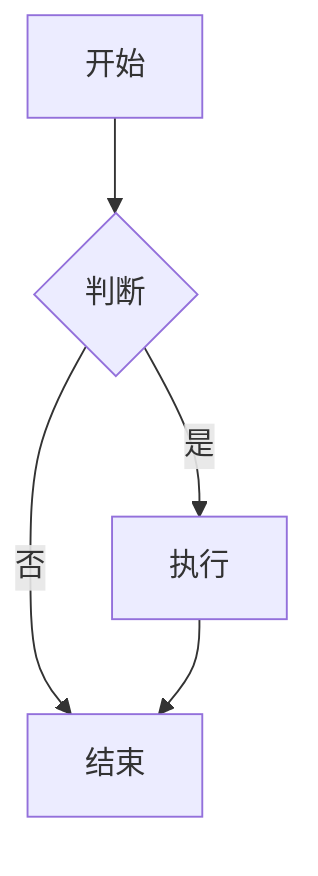
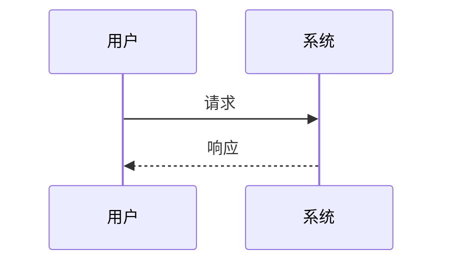

<!-- 这是一段 Markdown 注释，不会显示 -->

# Markdown 全样式示例文档

> [!caution]
>
> 这篇文章的目的是**作为一份 Markdown 全样式示例文档**，用来演示 我做的Python渲染器 所支持的语法和各种功能。

Markdown原文我放在[Gitee](https://gitee.com/ttwe77/ttwe77s-homepage/blob/main/tools/genblog/docs/MDTest.md)和[Github](https://github.com/ttwe77/ttwe77s-homepage/blob/main/tools/genblog/docs/MDTest.md)上了，渲染脚本在[Gitee](https://gitee.com/ttwe77/ttwe77s-homepage/blob/main/tools/genblog/md2page.py)和[Github](https://github.com/ttwe77/ttwe77s-homepage/blob/main/tools/genblog/md2page.py)，需要的自取。

若你在这个页面发现渲染问题，请前往[Issues](https://gitee.com/ttwe77/ttwe77s-homepage/issues)页面提交反馈。

> 说明：Markdown 有多种方言，本文覆盖 CommonMark、GFM 以及常见扩展。不同渲染器支持程度不同。

## 目录

- [1. 标题](#1-标题)
- [2. 段落与换行](#2-段落与换行)
- [3. 强调与文本样式](#3-强调与文本样式)
- [4. 引用](#4-引用)
- [5. 列表](#5-列表)
- [6. 代码](#6-代码)
- [7. 链接](#7-链接)
- [8. 图片](#8-图片)
- [9. 表格](#9-表格)
- [10. 分隔线](#10-分隔线)
- [11. HTML](#11-html)
- [12. 转义字符](#12-转义字符)
- [13. 脚注](#13-脚注)
- [14. 数学公式](#14-数学公式)
- [15. 图表 Mermaid](#15-图表-mermaid)
- [16. 徽章与表情](#16-徽章与表情)
- [17. 提示与折叠](#17-提示与折叠)
- [18. 媒体与嵌入](#18-媒体与嵌入)
- [19. 其他扩展](#19-其他扩展)

部分渲染器支持自动目录：

[TOC]

---

## 1. 标题

# H1 一级标题
## H2 二级标题
### H3 三级标题
#### H4 四级标题
##### H5 五级标题
###### H6 六级标题

一级标题 Setext
===

二级标题 Setext
---

## 2. 段落与换行

这是第一个段落。Markdown 中用一个空行分隔段落。

这是第二个段落。
这一行与上一行属于同一段落，通常渲染为同一段。

这一行末尾有两个空格，  
所以这里会强制换行。

这一行末尾使用反斜杠，\
也会强制换行。

也可以使用 HTML：第一行<br>第二行。

## 3. 强调与文本样式

*斜体* 或 _斜体_  
**粗体** 或 __粗体__  
***粗斜体*** 或 ___粗斜体___  
~~删除线~~  
<u>下划线</u>  
<ins>插入下划线</ins>  
<del>删除线 HTML</del>  
<mark>高亮</mark>  
==高亮（部分扩展）==  
H~2~O 下标（部分扩展）  
X^2^ 上标（部分扩展）  
<sub>下标</sub> 和 <sup>上标</sup>  
<small>小号文字</small>  
<abbr title="HyperText Markup Language">HTML</abbr>  
<cite>引用作品名</cite>  
<kbd>Ctrl</kbd> + <kbd>C</kbd>  
:smile: :rocket: :+1: （emoji 扩展）  
&copy; &amp; &lt; &gt; &nbsp;

## 4. 引用

> 一级引用
>
> 引用中可以包含 **粗体**、*斜体*、`代码`。
>
> > 二级嵌套引用
> >
> > > 三级嵌套引用

> [!NOTE]
> GFM 提示：普通信息。

> [!TIP]
> 提示信息。

> [!IMPORTANT]
> 重要信息。

> [!WARNING]
> 警告信息。

> [!CAUTION]
> 注意信息。

## 5. 列表

### 无序列表

- 项目一
- 项目二
  - 子项目 A
  - 子项目 B
    - 子项目
* 使用星号
+ 使用加号

### 有序列表

1. 第一项
2. 第二项
   1. 子项 2.1
   2. 子项 2.2
3. 第三项

从指定数字开始：

3. 第三项
4. 第四项

从指定数字开始：

3. 第三项
4. 第四项

### 任务列表

- [x] 已完成任务
- [ ] 未完成任务
- [ ] 带 **格式** 的任务
  - [x] 子任务

### 定义列表（部分扩展）

术语 1
: 定义 1

术语 2
: 定义 2
: 另一个定义

## 6. 代码

行内代码：`printf("Hello")`、`<div>`、`npm install`。

缩进代码块：

    function hello() {
      console.log("Hello");
    }

围栏代码块：

```javascript
function hello(name) {
  console.log(`Hello, ${name}!`);
}
```

```python
def hello(name: str) -> None:
    print(f"Hello, {name}!")
```

```diff
+ 新增行
- 删除行
! 注意行
+ 新增行
- 删除行
! 注意行
+ 新增行
- 删除行
! 注意行
+ 新增行
- 删除行
! 注意行
+ 新增行
- 删除行
! 注意行
+ 新增行
- 删除行
! 注意行
+ 新增行
- 删除行
! 注意行
+ 新增行
- 删除行
! 注意行
```

```text
纯文本代码块。
这里不能直接包含三个反引号，否则会提前结束代码块。
```

很长的代码
```python
#!/usr/bin/env python3
# -*- coding: utf-8 -*-
"""
minify_html.py —— 压缩 HTML，并同时压缩内联的 <style> / <script>

依赖：
    pip install htmlmin2 rcssmin rjsmin

用法：
    python minify_html.py index.html             # 就地覆盖（会先询问确认）
    python minify_html.py index.html -y          # 就地覆盖，不再询问
    python minify_html.py index.html -o out.html # 输出到指定文件
    python minify_html.py index.html -o -        # 输出到 stdout
    cat index.html | python minify_html.py       # 从 stdin 读，写到 stdout
    python minify_html.py ./public -y            # 递归压缩目录下所有 HTML（就地覆盖）
    python minify_html.py index.html --no-inline # 只压缩 HTML 结构
"""

from __future__ import annotations

import argparse
import inspect
import os
import re
import sys
from pathlib import Path

try:
    import htmlmin
    import rcssmin
    import rjsmin
except ImportError as exc:  # pragma: no cover
    sys.exit(f"缺少依赖：{exc}\n请先安装：pip install htmlmin2 rcssmin rjsmin")


# --------------------------------------------------------------------------- #
# 内联标签处理
# --------------------------------------------------------------------------- #

_STYLE_RE = re.compile(r"(<style\b[^>]*>)(.*?)(</style\s*>)", re.IGNORECASE | re.DOTALL)
_SCRIPT_RE = re.compile(
    r"(<script\b(?P<attrs>[^>]*)>)(?P<body>.*?)(</script\s*>)",
    re.IGNORECASE | re.DOTALL,
)
_TYPE_RE = re.compile(r"""\btype\s*=\s*(?:"([^"]*)"|'([^']*)'|([^\s>]+))""", re.IGNORECASE)

#: 这些 type 的 <script> 内容才是 JS，可以交给 rjsmin
_JS_TYPES = {
    "",
    "module",
    "text/javascript",
    "application/javascript",
    "text/ecmascript",
    "application/ecmascript",
    "text/jscript",
    "text/livescript",
    "text/x-javascript",
    "application/x-javascript",
}


def _is_js_script(attrs: str) -> bool:
    """判断 <script ...> 的内容是不是 JavaScript（JSON-LD / importmap 等要跳过）。"""
    match = _TYPE_RE.search(attrs)
    if not match:
        return True  # 没写 type，默认就是 JS
    value = (match.group(1) or match.group(2) or match.group(3) or "").strip().lower()
    return value in _JS_TYPES


def _minify_style_tags(html: str) -> str:
    """压缩所有 <style> 标签里的 CSS。"""

    def _replace(match: re.Match) -> str:
        opening, body, closing = match.group(1), match.group(2), match.group(3)
        if not body.strip():
            return opening + closing
        try:
            return opening + rcssmin.cssmin(body) + closing
        except Exception as exc:
            print(f"[warn] CSS 压缩失败，已跳过：{exc}", file=sys.stderr)
            return match.group(0)

    return _STYLE_RE.sub(_replace, html)


def _minify_script_tags(html: str) -> str:
    """压缩所有内联 <script> 里的 JS（带 src 或非 JS 类型的会跳过）。"""

    def _replace(match: re.Match) -> str:
        opening, attrs = match.group(1), match.group("attrs")
        body, closing = match.group("body"), match.group(4)

        if not body.strip() or not _is_js_script(attrs):
            return match.group(0)
        try:
            return opening + rjsmin.jsmin(body) + closing
        except Exception as exc:
            print(f"[warn] JS 压缩失败，已跳过：{exc}", file=sys.stderr)
            return match.group(0)

    return _SCRIPT_RE.sub(_replace, html)


# --------------------------------------------------------------------------- #
# 主压缩函数
# --------------------------------------------------------------------------- #

def _filter_supported_kwargs(func, kwargs: dict) -> dict:
    """把 kwargs 里当前版本 htmlmin.minify 不认识的键剔除掉。

    htmlmin 与 htmlmin2 的参数集不一样（例如 htmlmin2 去掉了 minify_css /
    minify_js），直接传过去会抛 TypeError。这里用签名自省做一层过滤，
    既兼容旧版也兼容新版。
    """
    try:
        sig = inspect.signature(func)
    except (TypeError, ValueError):
        return kwargs

    params = sig.parameters
    # 如果函数带 **kwargs，就全部保留
    if any(p.kind is inspect.Parameter.VAR_KEYWORD for p in params.values()):
        return kwargs

    return {k: v for k, v in kwargs.items() if k in params}


def minify_html_string(html: str, *, inline: bool = True) -> str:
    """压缩 HTML 字符串。

    :param inline: 是否压缩内联的 <style> / <script>
    """
    if inline:
        html = _minify_style_tags(html)
        html = _minify_script_tags(html)

    kwargs = {
        "remove_comments": True,                 # 去掉 HTML 注释
        "remove_empty_space": True,              # 去掉标签间多余空白
        "remove_all_empty_space": False,
        "reduce_boolean_attributes": True,       # checked="checked" -> checked
        "remove_optional_attribute_quotes": True,
        "keep_pre": True,                        # 保留 <pre> 内格式
        "pre_tags": ("pre", "textarea"),
        # 下面两项只有旧版 htmlmin 支持；htmlmin2 已移除。
        # 内联内容在上面已经手动压过，这里关掉即可。不支持的版本会自动忽略。
        "minify_css": False,
        "minify_js": False,
    }

    supported = _filter_supported_kwargs(htmlmin.minify, kwargs)
    dropped = sorted(set(kwargs) - set(supported))
    if dropped:
        print(
            f"[info] 当前 htmlmin 版本不支持参数：{', '.join(dropped)}，已自动忽略",
            file=sys.stderr,
        )

    try:
        return htmlmin.minify(html, **supported)
    except Exception as exc:
        print(f"[warn] HTML 压缩失败，返回内联压缩后的结果：{exc}", file=sys.stderr)
        return html


# --------------------------------------------------------------------------- #
# 文件 / 目录辅助
# --------------------------------------------------------------------------- #

_HTML_EXTS = {".html", ".htm", ".xhtml"}


def _confirm(prompt: str, assume_yes: bool) -> bool:
    """询问用户是否继续。assume_yes 为 True 时直接放行。

    提示写到 stderr，避免污染 stdout（例如 `> out.html` 重定向时）。
    """
    if assume_yes:
        return True
    sys.stderr.write(f"{prompt} [y/N] ")
    sys.stderr.flush()
    try:
        answer = sys.stdin.readline()
    except KeyboardInterrupt:
        sys.stderr.write("\n")
        return False
    if not answer:  # EOF（例如 stdin 被重定向且没有输入）
        sys.stderr.write("\n")
        return False
    return answer.strip().lower() in ("y", "yes")


def _print_stats(label: str | None, before: int, after: int) -> None:
    ratio = (1 - after / before) * 100 if before else 0.0
    prefix = f"{label}: " if label else ""
    print(f"{prefix}{before} -> {after} bytes  (-{ratio:.1f}%)", file=sys.stderr)


def _collect_html_files(root: Path) -> list[Path]:
    """递归收集目录下所有 HTML 文件（跳过以 . 开头的隐藏目录）。"""
    found: list[Path] = []
    for dirpath, dirnames, filenames in os.walk(root):
        dirnames[:] = sorted(d for d in dirnames if not d.startswith("."))
        for name in sorted(filenames):
            if Path(name).suffix.lower() in _HTML_EXTS:
                found.append(Path(dirpath) / name)
    return found


def _process_directory(root: Path, *, inline: bool, assume_yes: bool, quiet: bool) -> int:
    """递归压缩目录下的所有 HTML（就地覆盖）。"""
    files = _collect_html_files(root)
    if not files:
        print(f"[info] {root} 下没有找到 HTML 文件", file=sys.stderr)
        return 0

    if not _confirm(
        f"将就地压缩 {root} 下的 {len(files)} 个 HTML 文件（会覆盖原文件），是否继续？",
        assume_yes,
    ):
        print("已取消，未修改任何文件。", file=sys.stderr)
        return 1

    total_before = 0
    total_after = 0
    ok = 0
    failed = 0

    for path in files:
        try:
            source = path.read_text(encoding="utf-8")
        except (OSError, UnicodeDecodeError) as exc:
            print(f"[warn] 读取失败，已跳过 {path}：{exc}", file=sys.stderr)
            failed += 1
            continue

        result = minify_html_string(source, inline=inline)

        try:
            path.write_text(result, encoding="utf-8")
        except OSError as exc:
            print(f"[warn] 写入失败，已跳过 {path}：{exc}", file=sys.stderr)
            failed += 1
            continue

        before = len(source.encode("utf-8"))
        after = len(result.encode("utf-8"))
        total_before += before
        total_after += after
        ok += 1

        if not quiet:
            _print_stats(str(path), before, after)

    if not quiet:
        ratio = (1 - total_after / total_before) * 100 if total_before else 0.0
        tail = f"，{failed} 个失败" if failed else ""
        print(
            f"完成：{ok} 个文件，{total_before} -> {total_after} bytes  (-{ratio:.1f}%){tail}",
            file=sys.stderr,
        )

    return 1 if failed else 0


# --------------------------------------------------------------------------- #
# 命令行
# --------------------------------------------------------------------------- #

def main(argv: list[str] | None = None) -> int:
    parser = argparse.ArgumentParser(
        description="压缩 HTML，并同时压缩其中的内联 CSS / JavaScript。",
        formatter_class=argparse.ArgumentDefaultsHelpFormatter,
    )
    parser.add_argument(
        "input", nargs="?", default=None,
        help="输入 HTML 文件或目录（省略或用 - 表示从 stdin 读取）",
    )
    parser.add_argument(
        "-o", "--output", default=None,
        help="输出文件；省略时覆盖原文件，用 - 表示写到 stdout（目录输入时不可用）",
    )
    parser.add_argument(
        "-y", "--yes", action="store_true",
        help="覆盖原文件时不再询问确认",
    )
    parser.add_argument(
        "--no-inline", action="store_true",
        help="不压缩内联的 <style>/<script>",
    )
    parser.add_argument(
        "-q", "--quiet", action="store_true",
        help="不打印统计信息",
    )
    args = parser.parse_args(argv)

    inline = not args.no_inline

    # ---------- 1) 从 stdin 读取，写到 stdout ----------
    if args.input in (None, "-"):
        source = sys.stdin.read()
        result = minify_html_string(source, inline=inline)
        sys.stdout.write(result)
        if not args.quiet:
            _print_stats(None, len(source.encode("utf-8")), len(result.encode("utf-8")))
        return 0

    target = Path(args.input)
    if not target.exists():
        print(f"[error] 找不到路径：{target}", file=sys.stderr)
        return 2

    # ---------- 2) 目录：递归就地压缩 ----------
    if target.is_dir():
        if args.output is not None:
            print(
                "[error] 输入是目录时不能使用 -o/--output；目录模式会就地覆盖原文件。",
                file=sys.stderr,
            )
            return 2
        return _process_directory(
            target, inline=inline, assume_yes=args.yes, quiet=args.quiet
        )

    # ---------- 3) 单个文件 ----------
    if args.output is None:
        # 未指定输出 -> 就地覆盖，需要确认
        if not _confirm(f"是否覆盖原文件 {target}？", args.yes):
            print("已取消，未修改任何文件。", file=sys.stderr)
            return 1
        out_path: Path | None = target
    elif args.output == "-":
        out_path = None  # 写 stdout
    else:
        out_path = Path(args.output)

    try:
        source = target.read_text(encoding="utf-8")
    except (OSError, UnicodeDecodeError) as exc:
        print(f"[error] 读取失败 {target}：{exc}", file=sys.stderr)
        return 2

    result = minify_html_string(source, inline=inline)

    try:
        if out_path is None:
            sys.stdout.write(result)
        else:
            out_path.write_text(result, encoding="utf-8")
    except OSError as exc:
        print(f"[error] 写入失败 {out_path}：{exc}", file=sys.stderr)
        return 2

    if not args.quiet:
        _print_stats(
            str(target),
            len(source.encode("utf-8")),
            len(result.encode("utf-8")),
        )

    return 0


if __name__ == "__main__":
    raise SystemExit(main())
```

## 7. 链接

行内链接：[OpenAI](https://openai.com "OpenAI 官网")

行内链接：[OpenAI](https://openai.com)

自动链接：<https://www.example.com>

邮箱：<mailto:test@example.com>

锚点链接：[回到标题](#1-标题)

相对链接：[README](./README.md)

引用式链接定义：

[github]: https://github.com "GitHub"

## 8. 图片


带链接的图片：

[](https://example.com)

引用式图片：

![Logo][logo]

[logo]: https://ttwe77.cn/src/head.avif "Logo"

## 9. 表格

| 左对齐 |          居中对齐           | 右对齐 |
| :----- | :-------------------------: | -----: |
| 单元格 |           单元格            | 单元格 |
| 内容   |          **粗体**           | `代码` |
| 长内容 | [链接](https://example.com) |     42 |

转义管道：

| 名称   | 说明           |
| ------ | -------------- |
| A \| B | 使用 `\|` 转义 |

## 10. 分隔线

---

***

___

## 11. HTML

<div style="padding: 8px; border: 1px solid #ccc;">
  这是一个 HTML 块。
</div>

<p align="center">居中段落</p>

<details>
  <summary>点击展开</summary>
  折叠内容。
</details>
<span class="hover-hint">显示的文字<span class="hover-hint__tooltip"><span class="hint-title">提示标题（可选）</span>这里写提示内容，可以换行，支持简单文本。</span></span>

<!-- HTML 注释不会显示 -->

## 12. 转义字符

\*不是斜体\*  
\_不是斜体\_  
\# 不是标题  
\[不是链接\]  
\`不是代码\`  
\> 不是引用  
\+ 不是列表  
\- 不是列表  
\. 不是有序列表  
\! 不是图片  
\| 不是表格分隔符  
\{ \} \( \) \# \+ \- \. \!

## 13. 脚注

这里有一个脚注[^1]，这里还有另一个[^longnote]。

[^1]: 这是脚注内容。你可以点击右边箭头返回。

[^longnote]: 这是多行脚注。
    缩进可以继续脚注内容。
    
    也可以包含代码和列表：
    
    - 项目一
    - 项目二

## 14. 数学公式

行内公式：$E = mc^2$

块级公式：

$$
\frac{n!}{k!(n-k)!} = \binom{n}{k}
$$

行内公式：$E = mc^2$，还有 $a^2 + b^2 = c^2$。

$$
\frac{n!}{k!(n-k)!} = \binom{n}{k}
$$

```js
const price = "$9.9";  // 代码块里的 $ 不会被当公式
```


- `$E = mc^2$` → `<span class="math-inline">\(E = mc^2\)</span>`
- 多行 `$$…$$` → `<div class="math-block">\[\frac{n!}{k!(n-k)!} = \binom{n}{k}\]</div>`
- 代码块里的 `$` 被 `INLINE_CODE_RE` 先一步保护，不会误伤。

### 两个注意点

1. **美元号歧义**：正文里写 `价格是 $5 到 $10` 时，会被误判成行内公式。真要写美元，用 `\$` 转义（已有的 `BACKSLASH_ESCAPE_RE` 会处理）。
2. **`$$` 必须独占一行开头**：块级公式的触发条件是 `s.startswith("$$")`，别在段落中间直接塞 `$$…$$`。

## 15. 图表 Mermaid





## 16. 徽章与表情


:smile: :heart: :rocket:

## 17. 提示与折叠

> [!NOTE]
> 这是一个提示块。

<details>
  <summary>展开查看详情</summary>

  这里可以放 **Markdown** 内容。

  ```js
  console.log("Hello");
  ```
</details>

## 18. 媒体与嵌入

<iframe src="https://example.com" width="300" height="150"></iframe>

<iframe frameborder="no" border="0" marginwidth="0" marginheight="0" width=330 height=86 src="//music.163.com/outchain/player?type=2&id=2755332551&auto=0&height=66"></iframe>

## 19. 其他扩展

行内 HTML 与 Markdown 混合：<span style="color: red;">红色文字</span> 和 **粗体**。

键盘输入：<kbd>Ctrl</kbd> + <kbd>Alt</kbd> + <kbd>Delete</kbd>

上标/下标：H<sub>2</sub>O，E=mc<sup>2</sup>

缩写：<abbr title="Application Programming Interface">API</abbr>

高亮：<mark>重要内容</mark>

进度条：

<progress value="70" max="100">70%</progress>

## 20. 引用式链接汇总

[OpenAI][openai]  
[GitHub][github]

[openai]: https://openai.com
[github]: https://github.com
