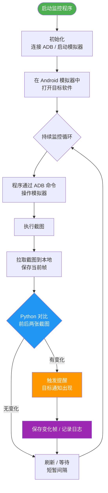

# 那个不肯弹通知的 App，被我用 Python 盯上了

早上好，今早来继续做一个项目。

因为我有些需求需要时刻盯着手机通知，但是有神奇的软件居然不发系统通知提醒我。于是我就想做一个持续监控软件。*至于是什么软件嘛，懂的都懂*

嗯既然是项目，我还是用下版本控制吧。然后把代码扔在云端给你们参考（虽然没啥价值就是了）

## 技术栈

先大致拟定一个技术栈吧。既然是要盯着手机看，就要判断屏幕是否有变化。我比较倾向截图+前后对比

然后考虑到手机一直开在那里，OLEDOLED（Organic Light-Emitting Diode，有机发光二极管）每个像素自己发光的屏幕，对比度高，但像素老化不均：同一处长期显示静止画面，那部分老化更快，会留下永久残影，也就是烧屏。 所以本文不敢拿真机长时间挂着，改用模拟器。屏可能会烧屏，而且我用的是水果牌手机不太好控制。我就打算用手机模拟器，省事放心。

理论存在，来先粗略策划一下具体实现：

我开一个Android的模拟器，里面开着目标软件。然后程序通过ADBADB（Android Debug Bridge，Android 调试桥）Android SDK 自带的命令行调试工具，能通过 USB 或 TCP 给真机/模拟器下发 shell 命令。 本文用它定时执行截图、把图片拉回电脑，再用 input swipe 触发下拉刷新。命令操作手机进行截图+刷新，Python再对比前后截图就好了

## 版本控制

用Git可谓是基操。我先去Gitee上弄了一个仓库，名字乱取。这是[链接](https://gitee.com/ttwe77/screen-watchdog)，代码都push上去了，需要自取。

## Python通知程序

我打算单独做一个Python通知程序，通过CLICLI（Command Line Interface，命令行界面）在终端里用参数调用程序的交互方式。 好处是能被别的程序直接脚本化调用——监控程序发现画面变化，一条命令就能把提醒弹出来。调用弹出通知。就是`notifier.py`

我的Prompt是：*用python写一个tkintertkinterPython 标准库自带的 GUI 工具包，基于 Tcl/Tk。装好 Python 就能用，不用额外装依赖；界面朴素，但写个小弹窗足够快。通知器。用CLI接入，默认置顶弹窗+系统通知+循环播放WAV`"C:\Windows\Media\Alarm01.wav"`。支持自定义提醒文案*

这三者强强联合绝对有效。让我测试一下

> python notifier.py -h
> usage: notifier.py [-h] [-t TITLE] [-w WAV]
>                    [--no-sound] [--no-toast]
>                    [--no-topmost] [--timeout TIMEOUT]
>                    [--snooze SNOOZE]
>                    message
>
> tkinter 桌面提醒：置顶弹窗 + 系统通知 + 循环播放 WAV
>
> positional arguments:
>   message               提醒正文（必填）
>
> options:
>   -h, --help            show this help message and
>                         exit
>   -t TITLE, --title TITLE
>                         弹窗 / 通知标题（默认：提醒）
>   -w WAV, --wav WAV     循环播放的 WAV 路径（默认：C:\Windows\Med
>                         ia\Alarm01.wav）
>   --no-sound            不播放声音
>   --no-toast            不发送系统通知
>   --no-topmost          弹窗不置顶
>   --timeout TIMEOUT     N 秒后自动关闭，0 表示不自动关闭（默认 0）
>   --snooze SNOOZE       “稍后提醒”按钮的分钟数，0 表示隐藏该按钮（默认 5）
>
> 示例:
>   python notifier.py "会议开始啦"
>   python notifier.py "喝水时间" -t "健康提醒" --timeout 30
>   python notifier.py "构建完成" -w D:\sounds\ding.wav --no-toast
>   python notifier.py "自定义文案" --snooze 10 --no-topmost

嗯功能还挺多，甚至隐藏执行Powershell还被火绒火绒安全国产安全软件，主打轻量、无捆绑弹窗，自带「敏感动作防护」。 其中一条内置规则就叫「隐藏执行 PowerShell」，所以第一版通知器偷偷调 PowerShell 弹窗时，直接被它按住了。拦截了，我让AI改改。

OK搞定，这版用的是win11toastwin11toast基于 WinRT 的 Python 第三方库（pip install win11toast），直接调 Windows 10/11 的原生 Toast 通知，不必自己拼通知 XML。 本文用它替掉了被火绒拦下的 PowerShell 方案。，火绒不报错了。

*不知怎的，我感觉网页版的DeepSeek降智有点严重啊。这还是我认识的DeepSeek吗？换成API就正常多了。*

## 屏幕监控程序

然后就是屏幕监控了，还是让AI写，先编一个Prompt：

> 写一个Python屏幕监控程序。程序通过ADB命令定期给手机截图并执行指定滑动刷新命令“adb shell input swipe”，如果屏幕变化就用notifier.py提醒用户。有GUI界面，PyQtPyQt / PyQt6Riverbank 维护的 Python 版 Qt 绑定，写桌面 GUI 很顺手；许可为 GPL 或商业授权，和 LGPL 的 PySide6 是两条路线。 本文用的是 PyQt6。。注意看rule.md和screen-watchdog.md。安卓环境已开好，adb的127.0.0.1:5555

然后AI问了几个问题：

> 用哪个 Qt 绑定？两个都装了，但 API 差异不小。
>
> ***PyQt6***
>
> 检测到变化后，监控该怎么继续？
>
> ***继续监控+冷却***
>
> 对比时要不要裁掉顶部状态栏？
>
> ***裁掉状态栏+底部导航***
>
> 下拉刷新的滑动方向？
>
> ***向下拉，触发下拉刷新***

这是我主动要求AI提问我的，避免我又给它打回去重写。

嗯看着AI自己写代码自己调试还挺享受的？就是烧了一堆Token不好受

OK写完了，我让AI自己把自己改了啥和踩过的坑都写进`history.md`里面了，让我测试一下。

测试软件就尽量选小一点的软件吧，于是我就去安装了**米游社米游社米哈游官方的游戏社区 App，集合原神、崩坏：星穹铁道等游戏的资讯、签到、帖子和私信。 本文拿它当「会收到消息、但不一定好好弹系统通知」的测试对象。**。我用别人的号给我自己的号发信息。第一次发消息也是马上就收到了信息。然后我继续测试，程序设计有60s内变化免打扰的设计。我继续发测试消息，果然没有提醒。之后我等待了60s之后继续测试，结果没有通知。我看了下日志，变化差异约是0.02%，而预设的阈值是0.05%。我就发现我发第二次消息的时候消息时间还是“刚刚”，这个文字没变过，也就只有红点变了。于是就没有通知，嗯好吧那我改。

OK很快AI就改好了，改得不错，各种功能也是让我眼花缭乱。我挺满意的，收工。

## README.md

最后我再烧点Token让AI写一个README.md吧...

让我看看它写的......emmm原来产物有这么多啊，我看看。

一个监控屏幕的功能居然被AI拆分成了3个py文件，各司其职。

- `screen_watchdog.py` 用PyQt6写的主界面
- `monitor.py` 用来对比前后两帧
- `adb_client.py` 用来找设备

甚至还有完整的可追溯证据，可以在captures/下看到变化时的截图。程序还把变化的部分涂红了，真是太智能了。
