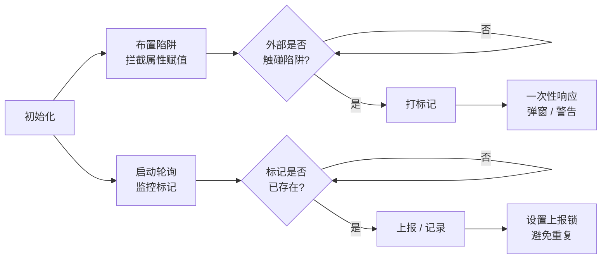

# 在线测试有感

## 引言

今天周末也是被拉去做在线测试了。测试居然是在电脑浏览器上做的，我也就不小心切出去了几次就说我违规操作，然后就被上报了。同时在答题的时候也不能选择文本和复制粘贴，我那时就有点好奇这是怎么做到的，于是我就在测试结束之后开始了研究。

## 运行原理

其实切出去的时候我去看了DevTools，然后正好看到了实现的代码。这里不方便把代码放出来，大致的原理是：



其实就是在那些控件上设“陷阱”，只要你：

```js
document.oncopy = null; document.onselectstart = null; document.oncontextmenu = null;
（把网页用来“拦截”你操作的事件处理函数清空）
```

就会炸。

但是这个代码**本身不具备任何拦截复制粘贴的能力**。它做的是“**钓鱼检测**”，不是“**拦截**”。

所以说拦截的函数得另写，我看看要拦截啥：

- 复制：<kbd>Ctrl</kbd>+<kbd>C</kbd>、<kbd>Ctrl</kbd>+<kbd>Insert</kbd>、<kbd>Menu</kbd>、<kbd>Shift</kbd>+<kbd>F10</kbd>
- 粘贴：<kbd>Ctrl</kbd>+<kbd>V</kbd>、<kbd>Shift</kbd>+<kbd>Insert</kbd>、<kbd>Windows</kbd>+<kbd>V</kbd>（上面一样的这里不写了）

> 啊让我想起了不好的回忆。因为习惯<kbd>Ctrl</kbd>+<kbd>C</kbd>复制，我在一次FFmpeg视频编码的时候复制内容，结果编了好久的视频被我<kbd>Ctrl</kbd>+<kbd>C</kbd>一键取消了呜呜呜。所以记好了，在终端复制粘贴不要图省事，一律用<kbd>Ctrl</kbd>+<kbd>Insert</kbd>

啊我毕生所学就只能想到这么多了。让我看看在JS那该怎么实现。

```js
document.addEventListener('copy', (e) => {
  e.preventDefault(); // 取消默认复制行为
});
```

啊？这么简单？

> *哇啊啊啊——我不活了——*
>
> ​         ——[才羽 桃井](https://kivo.wiki/data/character/2)

要不直接将题目绘制到 Canvas 中，直接降维打击。

之后我又去找了点资料，写出了这一段Prompt：

```text
写一个纯前端的html知识问答。题目只有一道主观题，有很强的反作弊
1.  把 onpaste、oncontextmenu、oncopy 等事件属性改成带 setter 的“陷阱属性”。第三方插件如果通过赋值方式修改这些属性，就会触发标记，随后判定违规。
2. 防止复制剪切粘贴、禁用右键与文本选择：将题目绘制到 Canvas 中。拦截复制剪切粘贴事件。
3. 增加篡改倒计时的难度
4. 防止切屏：切屏检测需要双通道监听blur和visibilitychange
5. 进入网页弹窗要求全屏，退出全屏算违规
6. 监听 beforeunload，弹出浏览器原生确认框，防止误关或试图通过刷新重置状态。
7. 拦截高危快捷键（在捕获阶段全局注册）、禁用拖拽与打印
8. 用 debugger 陷阱：定时执行 debugger;，如果 DevTools 打开，执行会暂停，通过时间差推断。

注意：
1. 在网页下方设置一个违规日志，详细说明用户违规原因。
2. 保留用户输入的内容和时间（本地存储，增大破解难度）
3. 真正价值不在于“防住”，而在于“让作弊变得麻烦，并且留下痕迹”
```

然后继续优化

> 1.进入网页后询问用户考生昵称、学院和学号，支持填入默认（昵称：“天童 凯伊”、学院：“千禧年科学学院”、学号：“10135”）。然后打上全局半透明水印。 
>
> 2.当用户按键的时候，题目变黑（防止截屏）。
>
> 3.优化用户体验。
>
> 4.让破解的难度更高

> 核对考生身份编辑框默认为空，只有按下填入预设按钮后才填入预设信息。按下填入预设按钮后按钮文字变为“换一版”，支持切换多个预设信息

> 重置按钮改为重置并刷新。每次按重置都会有2次违规

> 重置刷新并没有清除数据

> 在底部添加备案号和MIT开源和我的研究经过文章的链接（占位符）

> 应用滚动条样式

> 加 CSP meta
>
> 做更严格的 CSP，可以用python生成吗

> 关键逻辑放进 Worker / WASM
>
> （关键逻辑：bindAntiDebug 墙钟/单调时钟比对、bindAntiDebug 心跳间隔检测、logViolation 日志缓冲 + 上报队列、checkCanvasIntegrity 像素采样比对、计时 elapsed() / remaining()、drawQuestion 文本测量/换行）

> 添加监听器守卫（防止用户 removeEventListener）
>
> 继续添加DOM 守卫：水印/textarea/按钮被改自动恢复

累了，就这样吧，睡觉了（现在是2026-11-09 00:12）

演示站弄好了，你们可以：

ttwe77.cn-右上角菜单-我的工具-知识测试

或者直接点[链接](https://www.ttwe77.cn/tools/app/web-exam.html)

干测试时出BUG了，爬起来重新干